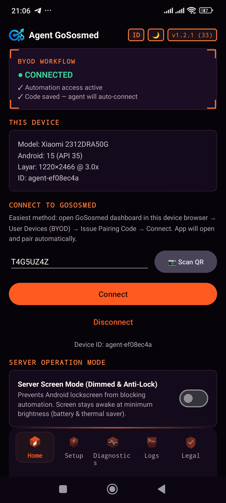
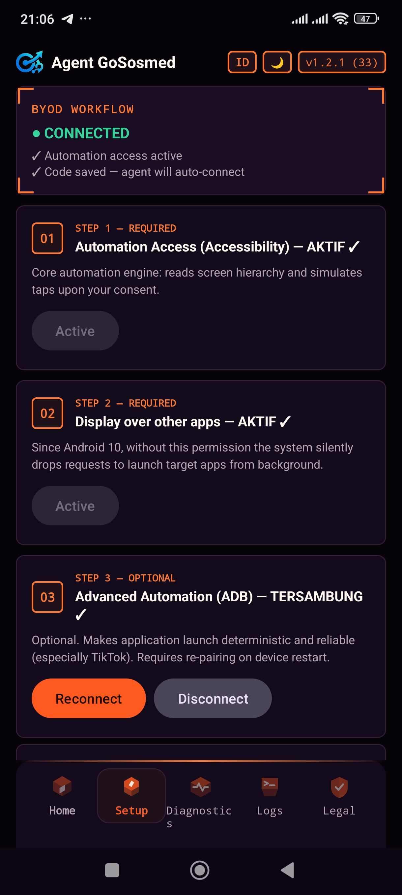
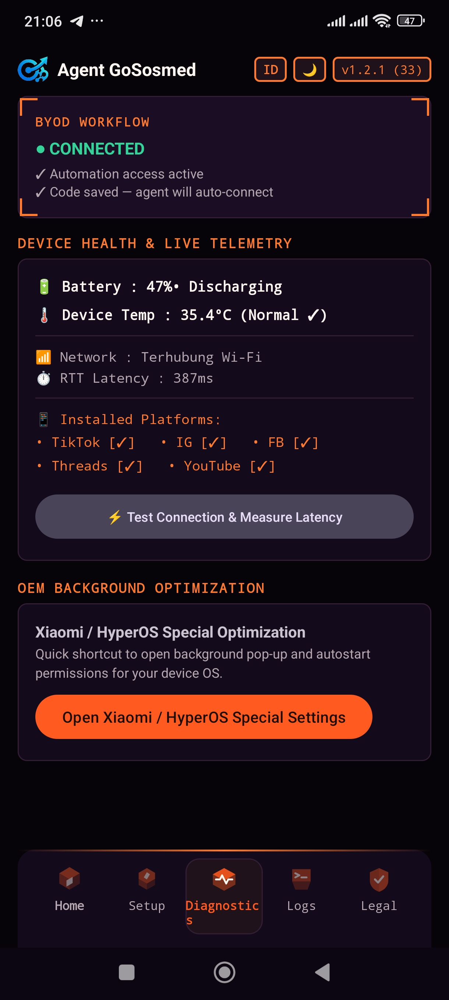
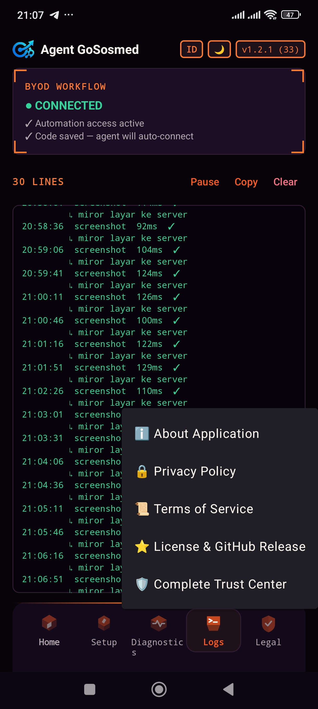

# GoSosmed Mobile Agent

**Enterprise-Grade Android Automation Engine for the GoSosmed BYOD (Bring Your Own Device) Architecture.**

This application connects physical Android smartphones directly to the GoSosmed automation cloud **without an intermediary PC, without root access, and without third-party frameworks**. Replacing vulnerable datacenter emulator farms that are prone to anti-fraud detection, GoSosmed orchestrates real physical devices with clean residential cellular network identities that are 100% compliant, secure, and resilient against platform bans.

🌐 **[English](README.en.md)** • **[Bahasa Indonesia](README.md)**

[](https://github.com/dedy45/gososmed-mobile-agent/actions/workflows/build.yml)
[](https://github.com/dedy45/gososmed-mobile-agent/releases)
[](https://bamsbung.id)
[](https://docs.bamsbung.id)
[](https://status.bamsbung.id)
[](LICENSE)

> **Active Version: v1.2.7 (Stable).**  
> Single Source of Truth (SSoT): `app/build.gradle.kts` (`versionName`) and [GitHub Releases](https://github.com/dedy45/gososmed-mobile-agent/releases).  
> **Standalone & Fully Integrated:** Since v0.9.0, privileged shell capabilities equivalent to ADB UID 2000 are built directly into this APK. You **no longer need Shizuku** or external pairing utilities.
---

## 📱 Application Screenshots (Production Mode v1.2.1)

GoSosmed Agent's native Android user interface features a sleek modern dark theme, intuitive navigation, and enterprise-grade transparency:

| **1. Home & BYOD Status** | **2. 3-Step Setup** | **3. Telemetry & Health** | **4. Live Logs & Privacy** |
|:---:|:---:|:---:|:---:|
|  |  |  |  |
| **WebSocket Connection & Pairing**<br>Live connection state, pairing code, QR scanner, and anti-lock dimmed screen mode for server operations. | **Accessibility & ADB Pairing**<br>Active validation of Step 1 (Accessibility), Step 2 (Overlay), and Step 3 (Embedded local Wireless ADB UID 2000). | **Telemetry & App Detection**<br>Real-time battery temperature monitoring (35.4°C), WebSocket round-trip latency, and installed social platform detection. | **Trust Center & Live Logs**<br>Sub-150ms command execution logs with one-tap access to Privacy Policy, Terms of Service, and open-source licenses. |

---
## 🏛️ Dual-Engine Control Plane Architecture

GoSosmed Mobile Agent engineers a native Android **Dual-Engine** architecture that operates concurrently with zero interference:

```
┌─────────────────────────────────────────────────────────────────────────────┐
│                          PHYSICAL ANDROID HARDWARE                          │
├──────────────────────────────────────┬──────────────────────────────────────┤
│  ENGINE 1: ACCESSIBILITY SERVICE     │  ENGINE 2: LOCAL ADB PRIVILEGED      │
│  (UID 10xxx — ~2ms Latency)          │  (UID 2000 — 127.0.0.1:5555 Loopback)│
├──────────────────────────────────────┼──────────────────────────────────────┤
│ • In-Memory UI Traversal (Depth 8+)  │ • Android 10+ Scoped Storage Bypass  │
│ • Set-of-Marks Painter (Ember 2048)  │ • Direct App Launcher (am)          │
│ • Semantic Non-Clickable Detection   │ • MediaScanner Broadcast Trigger     │
│ • Native Fast-Polling Reflex (80ms)  │ • Global 1% Screen Dimming Lock      │
│ • Semantic ACTION_CLICK Dispatch     │ • Strict Shell Binary Whitelist      │
└──────────────────────────────────────┴──────────────────────────────────────┘
                                  │
                  Outbound Connection (WSS / TLS 1.3)
                  Heartbeat · Auto-Reconnect · Anti-DDoS
                                  ▼
                [ GoSosmed Cloud / Local MCP Server ]
```

---

## ⚡ Command Capabilities Matrix (v1.1.0+)

This APK provides **28+ high-performance native commands** designed specifically for LLM token efficiency and publishing resilience:

| Category | Native Command | Architectural Advantage & Token Efficiency |
|---|---|---|
| **AI Vision & Marks** | `annotatedScreenshot` | Generates numbered Set-of-Marks badges `[1]`, `[2]` directly over interactive UI nodes on a native canvas. Features **Region of Interest (ROI)** sub-region cropping to zoom into CAPTCHAs and puzzle challenges with extreme token economy (~85 vision tokens). |
| **Compound Action** | `clickAndWait` | Taps target element and immediately waits for screen transition to settle in a single device-memory loop. **Eliminates 50% of LLM turn round-trips.** |
| **Fast Reflex** | `waitForNode` | Native in-memory polling (80ms interval, <200ms latency) with zero XML serialization overhead. |
| **Input & Forms** | `replaceText` | Clears target fields, inputs Unicode text (Indonesian language & emojis), auto-dismisses soft keyboards, and supports `submit: true` for one-shot search execution. |
| **Media Lifecycle** | `stageMedia` | Autonomous HTTP streaming of video/image assets directly into shared storage (`DCIM/Camera`) with byte length and SHA-256 integrity validation. |
| **Gallery Scrubber** | `cleanupMedia` | Cleans duplicate testing media legally via `ContentResolver.delete()` and triggers `MediaScannerConnection` to prevent phantom thumbnails. |
| **Deterministic v2** | `observe`, `resolve`, `actAndVerify` | Stable `snapshot_id`-based execution, settle state verification, clickable-ancestor propagation, and zero ambiguous taps. Emits `verified`, `action_performed`, and deterministic `nodes_digest`. |
| **Maestro Parity** | `scrollUntilVisible`, `spatialFilter` | Native in-memory scroll-and-search within safe viewport (15%–85% of display height) and 2D relative spatial element filtering (`below`, `above`, `leftOf`, `rightOf`) based on nearest Euclidean distance. |
| **Live Remote Control** | `startLocalServer`, `remoteControl` | Hardware-accelerated 60 FPS H.264 screen streaming (WebCodecs/MSE) and real-time touch injection over local Wi-Fi browser (Port 8765/8766). |
| **Power Management** | `globalDim` | Locks global Android brightness to 1% via ADB shell, keeping batteries cool and preventing AMOLED display burn-in during 24/7 automation. |
| **System Diagnostics**| `health`, `capabilities` | Full diagnostic telemetry reporting WebSocket link status, Accessibility readiness, battery level, temperature, and OEM device specifications. |
---
## 🎮 Remote Live Streaming & Control (Dual-Engine H.264 / WebCodecs)

GoSosmed Agent incorporates a zero-copy hardware screen streaming engine and real-time touch injection. For operational clarity and network efficiency, access is divided into **two distinct pathways**:

### 1. Local Browser Access (LAN User-End) — Active & Unlimited
* **Access URLs:** `http://[PHONE-IP]:8765` (HTTP Mode / MSE fMP4 Muxer) or `https://[PHONE-IP]:8766` (HTTPS Mode / WebCodecs 60 FPS).
* **Target Use Case:** Users wanting to monitor and operate the smartphone directly from their desktop or laptop browser on the same Wi-Fi network.
* **Highlights:**
  * **Sub-50ms Ultra-Low Latency:** Zero-copy MediaCodec hardware encoding (*Qualcomm/MediaTek/Exynos*) with `SpsFix.annexB` buffer-reorder bypass.
  * **Zero Cloud Bandwidth:** Video traffic streams exclusively over your local router, consuming 0 KB of internet or cellular data.
  * **Per-Session Security:** Protected by a dynamic 6-digit session PIN displayed on the phone, a 192-bit HttpOnly authentication cookie (`SameSite=Strict`), and an automatic lockout after 8 failed attempts.

### 2. Remote Relay via Cloud Web Dashboard — Disabled (Enterprise Plans Only)
* **Status:** **Disabled by default** in this open-source build.
* **Transparent Rationale:**
  * Continuous 60 FPS high-definition video streaming (720p/1080p) consumes **2 to 5 Mbps of continuous upstream bandwidth per active device**.
  * Relaying live streams for dozens of devices across public cloud servers incurs severe server bandwidth costs and demands dedicated WebRTC/TURN infrastructure.
  * As a consequence, remote relay through the central cloud dashboard (`https://dev-app.bamsbung.id/byod`) is reserved exclusively for paid enterprise subscription plans.
  * Open-source and BYOD users can utilize the local LAN browser viewer for unlimited, unmetered access.

---


## 🔒 Enterprise Trust & Privacy Center

Because this agent operates on personal devices and requests the **Accessibility Service**, security and transparency are paramount:

### 1. Zero-Spyware & Anti-Keylogger Guarantee
* **Automatic Password Redaction:** All Android input fields flagged with `isPassword` are automatically redacted to `[REDACTED]`. The system never reads, stores, or transmits personal social media credentials.
* **Device-Side Session Storage:** Users authenticate manually within official social media apps (Instagram, TikTok, etc.). Credentials never leave the sandboxed storage of the target application.

### 2. Strict Scoped Storage Isolation
* **Personal Media Is 100% Untouched:** Media deletion routines are cryptographically and strictly locked to file prefixes `gosmed_*`, `reel_*`, and `staged_*`.
* **Guaranteed Privacy:** Personal camera photos, family videos, and private downloads (`IMG_*`, `VID_*`, WhatsApp Media) are **contractually and programmatically isolated and will never be accessed or deleted**.

### 3. Least-Privilege Shell Execution
* Privileged shell commands are strictly whitelisted in `PrivilegedShell.ALLOWED_BINARIES`: only allowing `am`, `input`, `pm`, `dumpsys`, `wm`, `settings`, `cmd`, `rm`, and `svc`.
* Malicious actions—such as inspecting SMS messages, reading contacts, or tampering with core operating system files—are fundamentally blocked at the APK kernel level.

### 4. Unidirectional Network Security (Outbound-Only TLS)
* Your phone does not need a public IP address, requires no open inbound listening ports, and cannot be reached externally. All communication flows through an outbound persistent TLS 1.3 WebSocket authenticated via single-use pairing codes.

### 5. Cryptographic Device Attestation (Official Release Keystore Verification)
* The APK computes its official release certificate SHA-256 fingerprint (`74197a2440023bdb4eee85b1fc7d1585387b14b32f4a4c87b22978d7f28f27fa`) at runtime and delivers it in the WebSocket `register` handshake. The backend validates this signature to ensure only official GoSosmed release builds can connect, blocking unofficial third-party modified APKs.

### 6. Anti-MITM Proxy Hardening & Strict Modern TLS
* All network transport enforces modern TLS 1.2/1.3 (`MODERN_TLS`/`RESTRICTED_TLS`) and is fortified via `network_security_config.xml`, strictly pinning trust anchors to official System Root CAs for `bamsbung.id`. User-installed root certificates (Charles Proxy, Burp Suite, mitmproxy) are fundamentally rejected.

### 7. Zero-Leak Memory Architecture
* Set-of-Marks bitmap allocations utilize direct mutable decoding (`inMutable = true`) to eliminate duplicate 12.6 MB allocations, and all graphic/node resources are governed by guarded `try ... finally` recycling blocks, ensuring 0% memory accumulation over 24/7 continuous runs.

---

## ⚠️ Google Play Store Compliance Notice

This agent leverages the **Android Accessibility Service for UI automation**. Google Play Store public distribution policies prohibit publishing apps that utilize Accessibility APIs for purposes outside of general accessibility assistance.

| Distribution Channel | Status | Description |
|---|---|---|
| **Direct Sideload APK (BYOD)** | **Officially Supported** | Standard deployment path for physical device owners |
| **Play Console Internal / Closed Track** | Supported | For internal enterprise and controlled team testing |
| **Public Google Play Store (Production)** | Not Available | Prohibited by Google policy for automation utilities |

---

## 🛠️ Quick 3-Step Setup Guide

> Comprehensive walkthrough and troubleshooting available in **[3-Step Setup Guide](docs/SETUP-3-LANGKAH.md)** and **[Documentation Index](docs/)**.
```bash
# Install APK binary via ADB (or copy directly to phone storage)
adb install -r app-debug.apk
```

1. **Step 1 — Accessibility Service (Mandatory):**  
   Navigate to **Settings → Accessibility → GoSosmed Agent** → Enable.
2. **Step 2 — Display Over Other Apps (Mandatory):**  
   Navigate to **Settings → Apps → GoSosmed Agent → Display over other apps** → Enable. (On Xiaomi/HyperOS ROMs, also enable *Autostart*).
3. **Step 3 — Wireless ADB / Advanced Control (Highly Recommended):**  
   Enable **Developer Options → Wireless Debugging**. Tap **Connect** inside the agent app to trigger automated local pairing to `127.0.0.1`.
4. **Automation Screen Dimming (Optional):**  
   Toggle the **"Automation Screen Dimming"** switch located directly beneath Wireless ADB to keep your screen locked at 1% brightness overnight.

---

## 🏗️ Building from Source

### Method 1 — GitHub Actions CI/CD (Recommended)
Every commit pushed to `main` or `dev` triggers automated clean builds published to Artifacts/Releases:
```bash
gh workflow run build-apk --repo dedy45/gososmed-mobile-agent
```

### Method 2 — Local Compilation (Windows / macOS / Linux)
Prerequisites: JDK 17, Android SDK Platform 34, Build-Tools 34.0.0. Complete local toolchain setup guide is documented in **[TOOLCHAIN-LOKAL.md](docs/TOOLCHAIN-LOKAL.md)**.
```powershell
# In PowerShell / Terminal:
git clone https://github.com/dedy45/gososmed-mobile-agent.git
cd gososmed-mobile-agent

# Build Debug APK
gradle assembleDebug     # Output: app/build/outputs/apk/debug/app-debug.apk

# Build Release APK (Signed)
gradle assembleRelease
```

---

## 📜 License & Software Integrity

This repository is licensed under the **[Apache License 2.0](LICENSE)** — Copyright © 2026 Dedy (dedy45).

* **Release Integrity:** Every officially published APK binary is cryptographically signed and tagged with SHA-256 checksums documented on [GitHub Releases](https://github.com/dedy45/gososmed-mobile-agent/releases).
* **Clean-Room Engineering:** All memory control primitives, message wire formats, and serializers were authored independently adhering to open standards from the Android Open Source Project (AOSP).

---

## 🤖 AI Coding Agent Integration & Official Skill (MCP)

This repository includes the canonical operational harness and skill for AI Coding Agents (Claude Code, OpenAI Codex, Cursor IDE, Windsurf):
* **Official Skill File:** [`skills/gososmed-mobile-mcp/SKILL.md`](skills/gososmed-mobile-mcp/SKILL.md)
* **Instant Installation (1-Liner):**
  ```bash
  # For Claude Code
  mkdir -p .claude/skills/gososmed-mobile-mcp && \
  curl -fsSL https://raw.githubusercontent.com/dedy45/gososmed-mobile-agent/main/skills/gososmed-mobile-mcp/SKILL.md -o .claude/skills/gososmed-mobile-mcp/SKILL.md

  # For OpenAI Codex / Cursor / Universal Agents
  mkdir -p .agents/skills/gososmed-mobile-mcp && \
  curl -fsSL https://raw.githubusercontent.com/dedy45/gososmed-mobile-agent/main/skills/gososmed-mobile-mcp/SKILL.md -o .agents/skills/gososmed-mobile-mcp/SKILL.md
  ```

---

## 🌐 Official Bamsbung Ecosystem & Services

* **Main SaaS Platform:** [bamsbung.id](https://bamsbung.id)
* **Official Documentation:** [docs.bamsbung.id](https://docs.bamsbung.id)
* **System Status & Uptime:** [status.bamsbung.id](https://status.bamsbung.id)
* **GitHub Repository:** [github.com/dedy45/gososmed-mobile-agent](https://github.com/dedy45/gososmed-mobile-agent)
